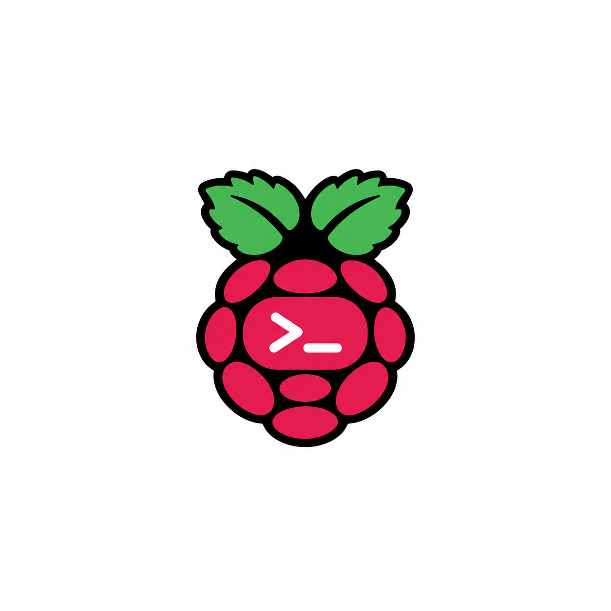
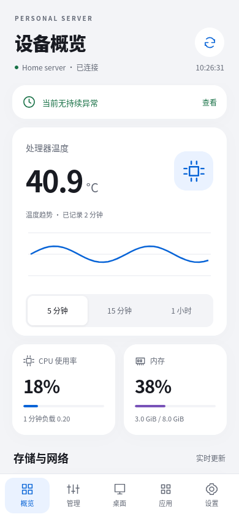
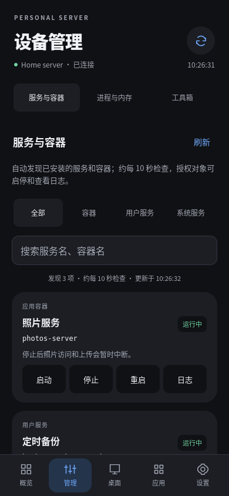

<p align="center"></p>

# Pi Console

**Turn a spare Android phone into a remote screen and control terminal for your Raspberry Pi.**

Also manage your Raspberry Pi or another Linux server from the same app.

Check resource usage, manage application processes, services and containers, read logs, transfer files, and connect to an optional remote desktop. Run the backend on your own server, enter its HTTPS address in the app, and pair the device.

[中文文档](README.md) · [Test builds](https://github.com/leo-kendall/pi-console/releases) · [Human deployment guide](docs/deployment.md) · [AI deployment runbook](docs/deployment-ai.md) · [Features](docs/features.md) · [Android compatibility](docs/android-compatibility.md) · [Configuration](docs/configuration.md) · [Build](docs/build.md) · [Maintenance](docs/maintenance.md) · [Uninstall](docs/uninstall.md)

## Screenshots

<p> </p>

Demo data: overview and service management.

## Features

- Guided server setup with credential-free HTTPS diagnostics, device pairing and read-only optional feature checks. Older backends can still be paired manually.
- Live CPU, temperature, memory, disk and network metrics with sampling history.
- Automatic discovery of systemd services and Docker containers. Persistent controls and logs require configuration; eligible running applications can also be stopped after one-time confirmation.
- Process details and sorting by memory or CPU. Application processes can be terminated normally; essential system processes remain read-only.
- Configured local RDP or classic VNC desktop, landscape fullscreen, adaptive/fixed/custom sizes and selectable aspect ratios up to 2560 × 1440. A spare phone can replace a separate monitor for everyday remote GUI work.
- An isolated file area with uploads, downloads, renaming and trash/restore, up to 8 GiB per file.
- Alerts, storage analysis, limited cache cleanup, a health summary and configuration backup.
- Custom links to your web applications.
- Phone-managed device and service grants, verified update downloads, log follow/filter/export, and local deployment checks with private upgrade backups and rollback.
- Durable foreground file queues, pause/resume, batch actions and explicitly configured named directories.

## Current limitations

This is a beta, mainly exercised on Ubuntu ARM64. The app UI is currently in Chinese.

- Some GPU/WebView combinations may still have rendering issues. Layout scaling, balanced safe areas and selectable render modes are available; hardware compatibility still requires real-device validation. The display check exports aggregate diagnostics.
- Desktop support targets configured local RDP and classic VNC. WayVNC TLS/VeNCrypt/RA2 authentication is not supported; see [desktop compatibility](docs/desktop-compatibility.md).
- Touchpad gestures, text sending, physical keyboard/mouse, modifier keys and explicit bidirectional text clipboard are available. Android-reserved shortcuts may remain local.
- Save up to 32 independently paired server profiles and connect to one at a time. Backend devices have administrator, operator or viewer roles; authorized devices share that server's configured resources and file spaces.

## Getting started

Requires Linux, Python 3.11+, a systemd user session and Android 8.0+ with a capable, enabled system WebView. Docker and desktop components are optional.

```sh
git clone https://github.com/leo-kendall/pi-console.git
cd pi-console
python3 -B server.py
```

The backend listens on `127.0.0.1:18765`. Set up a reachable HTTPS reverse proxy with an Android-trusted certificate matching the address. Public networks, LANs and VPNs are supported; the supplied [Caddy example](deploy/Caddyfile.example) restricts traffic to Tailscale by default.

Install a [test APK](https://github.com/leo-kendall/pi-console/releases) or [build one](docs/build.md). Enter the HTTPS API base address in Settings, for example `https://console.example.test/pi-console`.

In another terminal, from the same backend directory, generate a pairing code:

```sh
cd /path/to/pi-console
python3 -B control.py pair
```

Enter the one-time eight-character code in the app. A fresh install has no preset server or paired identity. Administrators can grant exact resource actions from the app toolbox. For local configuration, copy `config.example.json` to `config.json`, replace the examples with your own resources, and restart the backend. See [configuration](docs/configuration.md) and [automatic discovery](docs/auto-discovery.md).

## Development

The backend uses the Python standard library. The Android app uses Java, a local WebView UI and Apache Guacamole for desktop protocol handling. Android builds require JDK 17+ and Android SDK 35. See [build instructions](docs/build.md), [contributing](CONTRIBUTING.md), and [security reporting](SECURITY.md).

## License

Code is licensed under [Apache-2.0](LICENSE), allowing commercial use and closed-source derivatives under its terms. See [third-party notices](THIRD_PARTY_NOTICES.md).

The raspberry-shaped terminal icon is excluded from the project's Apache-2.0 grant. Its third-party branding rights have not been cleared; obtain applicable permission or replace it before distribution or commercial use. See [commercial use](docs/commercial-use.md).
