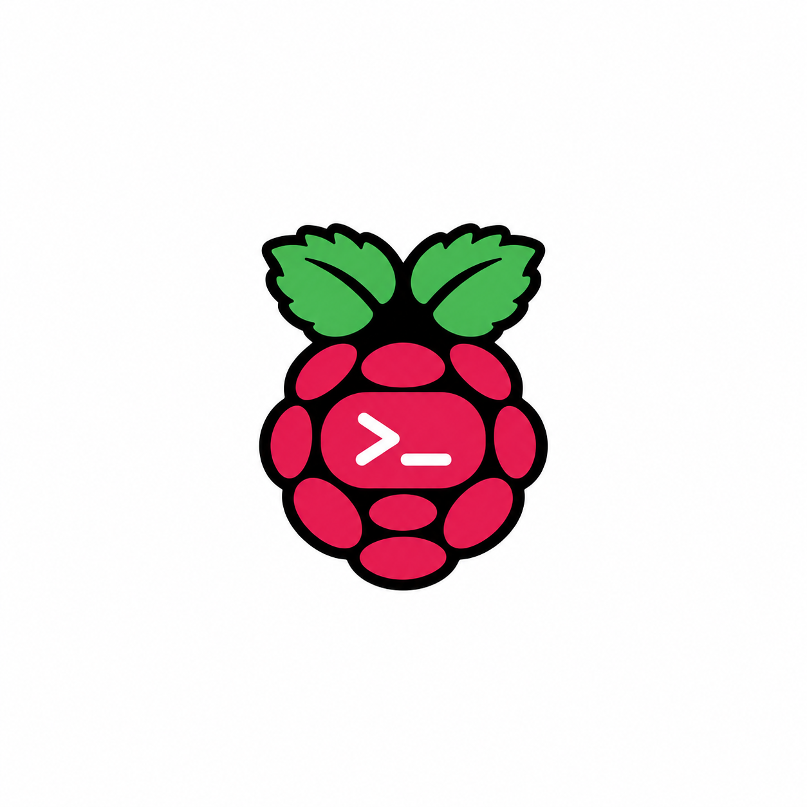
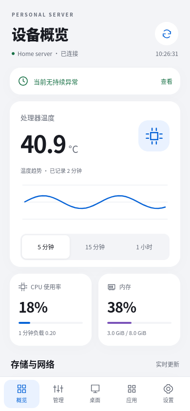
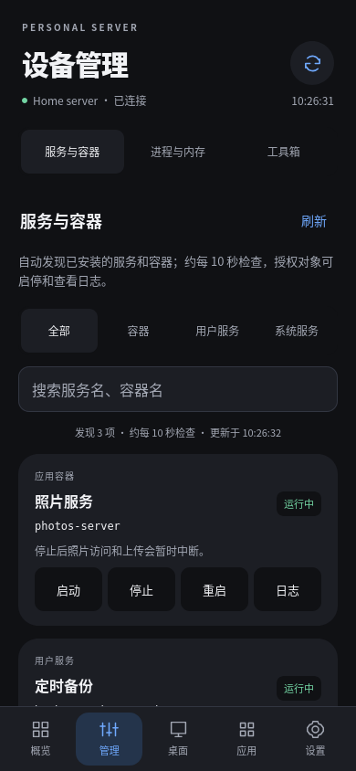

<p align="center"></p>

# Pi Console

用 Android 手机管理树莓派和其他 Linux 服务器。

查看资源占用，管理进程、服务和容器，读日志、传文件，或连接服务器桌面。后端部署在自己的服务器上，手机填写地址后配对使用。

[English](README.en.md) · [下载测试版](https://github.com/leo-kendall/pi-console/releases) · [部署](docs/deployment.md) · [配置](docs/configuration.md) · [构建](docs/build.md) · [卸载](docs/uninstall.md)

## 界面

<p> </p>

示例数据；左侧为概览，右侧为服务管理。

## 可以做什么

- **连接配置引导**：分步填写地址、检测 HTTPS 与后端身份、配对手机，并查看可选功能配置；检测不保存地址或发送配对凭据。
- **查看运行状态**：CPU、温度、内存、磁盘、网络和采样历史。
- **管理服务与容器**：自动发现 systemd 服务和 Docker 容器，按名称搜索和分类查看。启停、重启和日志需要配置授权；非关键运行对象也可以在 App 中单次确认结束。
- **查看进程**：按内存或 CPU 排序，查看进程详情，正常结束应用进程。系统基础进程只读。
- **操作远程桌面**：连接已配置的 GNOME Remote Login/RDP，横屏全屏、自适应缩放，最高 2560 × 1440。
- **传输文件**：在独立文件区上传、下载、重命名，移入回收区后可恢复。单文件上限 100 MiB。
- **处理日常维护**：告警记录、存储分析、有限缓存清理、健康概览和配置备份。
- **收纳应用入口**：把常用网页服务加入“应用”页，在 App 内或外部浏览器打开。

## 先了解这些限制

目前是测试版，主要在 Ubuntu ARM64 上使用和验证。

- 部分 Android 设备在横屏桌面中，把鼠标移到边缘或角落会出现黑块，**尚未修复**。App 的“画面检查”可导出诊断统计。
- 桌面模块目前只集成 GNOME Remote Login/RDP。Raspberry Pi OS 默认的 VNC/WayVNC 尚不支持，见[桌面兼容范围](docs/desktop-compatibility.md)。监控等其他模块不依赖桌面。
- 可以使用触摸板式手势、文字发送和屏幕按键；实体键盘直通与任意组合快捷键尚未实现。
- 一次连接一台服务器；同一后端的配对设备共享该服务器的资源配置和数据。

## 开始使用

服务器需要 Linux、Python 3.11+ 和 systemd 用户会话，手机需要 Android 8.0+。Docker 与远程桌面组件按需安装。

### 1. 启动后端

```sh
git clone https://github.com/leo-kendall/pi-console.git
cd pi-console
python3 -B server.py
```

后端默认监听 `127.0.0.1:18765`。需要后台常驻时，按照[部署说明](docs/deployment.md)安装用户服务。

### 2. 配置 HTTPS 入口

用反向代理将后端接到手机能够访问的 HTTPS 地址。可以使用公网、局域网或 VPN；证书必须与地址匹配，并受 Android 系统信任。

[Caddy 示例](deploy/Caddyfile.example)默认只允许 Tailscale 来源，其他网络需要调整访问规则。后端安装器不会代为修改代理配置。

### 3. 安装 App 并配对

从 [Releases](https://github.com/leo-kendall/pi-console/releases) 下载测试 APK，或[自行构建](docs/build.md)。在手机“设置”中填写 HTTPS API 地址，例如 `https://console.example.test/pi-console`。

另开一个服务器终端，进入同一份后端目录，生成配对码：

```sh
cd /path/to/pi-console
python3 -B control.py pair
```

在 App 中先“保存并继续”，再填入 8 位一次性配对码。配对后可点“检查连接与功能”，确认状态读取和可选功能配置。首次安装没有预设服务器、配对身份或应用入口。

“检测这个地址”会区分域名解析、连接、证书、跳转和后端响应问题；不改变已有配对。旧版后端没有检测接口时，仍可直接保存、配对。详见[连接诊断](docs/configuration.md#连接引导与诊断)。

### 4. 按需开放控制权限

自动发现不需要编辑配置。需要持久启停或读取日志时，复制并修改示例：

```sh
cp config.example.json config.json
```

将服务名称、容器、目录等改为自己的值，再重启后端。默认资源授权清单为空；管理员进程管理和桌面组件需另行安装，见[配置说明](docs/configuration.md)和[自动发现](docs/auto-discovery.md)。

## 开发

后端只使用 Python 标准库。Android 客户端使用 Java 和本地 WebView 界面，桌面协议由 Apache Guacamole 处理。

```sh
python3 -B -m unittest discover -s tests -p 'test_*.py'
python3 -B -m unittest discover -s remote-desktop -p 'test_*.py'
python3 -B scripts/test_java.py
node tests/test_app_state.cjs
node tests/test_desktop_layout.cjs
node tests/test_desktop_diagnostics.cjs
node tests/test_desktop_edge_probe.cjs
```

Android 构建需要 JDK 17+ 与 Android SDK 35，详见[构建说明](docs/build.md)。测试版 APK 使用开发签名。

反馈问题请附上版本、系统环境、复现步骤和去除私人信息的诊断。提交代码前请阅读 [CONTRIBUTING.md](CONTRIBUTING.md)；安全问题使用[私密报告渠道](SECURITY.md)。

## 许可证

代码采用 [Apache-2.0](LICENSE)，允许商业使用和闭源衍生。第三方组件声明见 [THIRD_PARTY_NOTICES.md](THIRD_PARTY_NOTICES.md)。

当前树莓果实终端图标不在项目的 Apache-2.0 授权范围内，其第三方品牌权利尚未确认。分发或商用前请取得适用授权，或替换为权利明确的图案。详见[商业使用说明](docs/commercial-use.md)。
